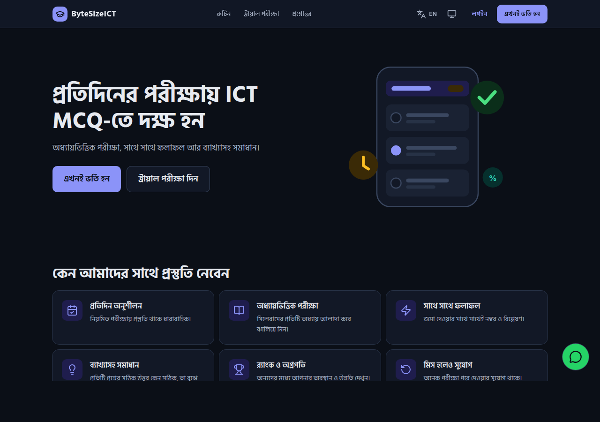

# ByteSizeICT

A mobile-first, **Bangla-first** exam platform for HSC students practising the ICT MCQ paper. A visitor can try a free exam and enrol; a student sits timed exams on a single scrolling page that never loses answers; and the coach manages everything from one admin panel.

**Live demo:** https://byte-size-ict.vercel.app



## Features

**For visitors**
- Landing page with plans and pricing, exam routine PDFs, a FAQ and a free **trial exam** (no login).
- Enrolment by manual payment (bKash, Nagad, Rocket, bank): a short form with mobile, email, payment method and transaction ID, with duplicate-transaction checks.

**For students**
- Login with mobile number and PIN, a forced PIN change on first login, and a single active session per account.
- A dashboard with the live or next exam, a personal routine and subscription status.
- A single-page exam with a countdown timer, a question navigator, mark-for-review and **local-first autosave** (answers survive refreshes and dropped connections). Time and scoring are handled on the server, and correct answers are never sent to the browser before submission.
- Instant results with rank, per-question review and explanations; past results; Bangla/English and light/dark toggles.

**For the admin**
- Separate secure login, dashboard overview and an admissions queue with one-click approval (creates the student, generates a PIN and emails the credentials).
- Student management with renewals, suspensions and an audit log.
- A structured question bank (Subject → Chapter → Topic → Question) with LaTeX, images and bulk import from Excel or CSV.
- An exam builder, results and rankings, CSV export, site settings and a Google Sheets mirror.

## Tech stack

| Area | Choice |
|---|---|
| Framework | Next.js 16, React 19, TypeScript |
| Styling | Tailwind CSS v4, Radix UI, next-themes |
| Database | Supabase Postgres with row-level security (19 migrations) |
| Auth | Custom session auth with argon2id-hashed PINs and passwords |
| Email | Resend with React Email templates |
| i18n | next-intl (Bangla and English) |
| Validation | Zod |
| Testing | Vitest, Testing Library, Playwright (end-to-end and axe accessibility), Supabase DB tests |
| Hosting | Vercel (Singapore region) and Supabase |

## Getting started (local)

**Requirements:** Node.js 22, pnpm 10.18, Docker (for the local Supabase stack).

```bash
pnpm install
cp .env.example .env.local     # then fill in the values as described in the file
pnpm db:start                  # starts local Supabase (Docker)
pnpm db:reset                  # applies migrations and loads seed data
pnpm dev                       # http://localhost:3000
```

Create an admin account with `pnpm admin:create`.

Useful scripts:

| Command | What it does |
|---|---|
| `pnpm test` | Unit and integration tests (Vitest) |
| `pnpm test:e2e` | End-to-end and accessibility tests (Playwright) |
| `pnpm db:test` | Database and RLS tests |
| `pnpm ci` | The full local check: lint, types, tests, i18n and secret checks |

`supabase/seed.sql` is for local development only. Never run it against a production database.

## Documentation

All design documents are in [`docs/`](docs/):

- [`01_PRD.md`](docs/01_PRD.md): product requirements and user stories
- [`02_AppFlow.md`](docs/02_AppFlow.md): routes, guards and screen behaviour
- [`03_UI_Spec.md`](docs/03_UI_Spec.md): design tokens and components
- [`04_TRD.md`](docs/04_TRD.md): technical requirements and stack
- [`05_Schema.md`](docs/05_Schema.md): database schema, RLS and SQL functions
- [`RUNBOOK.md`](docs/RUNBOOK.md): production deployment and operations
