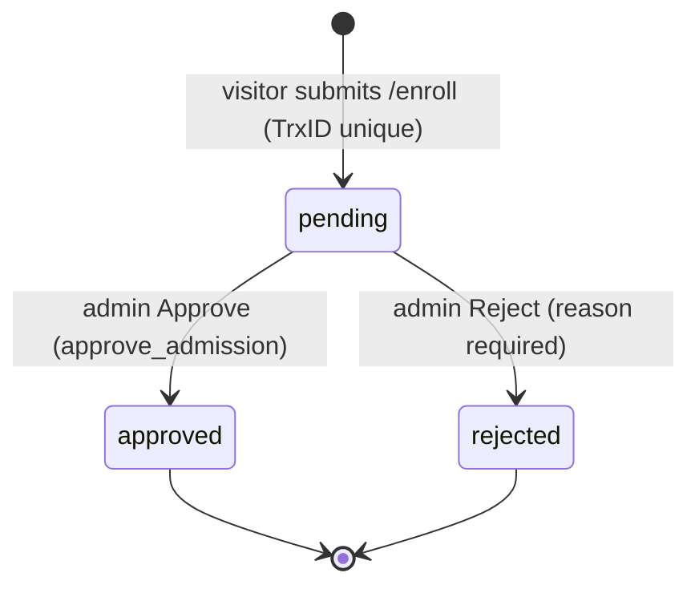
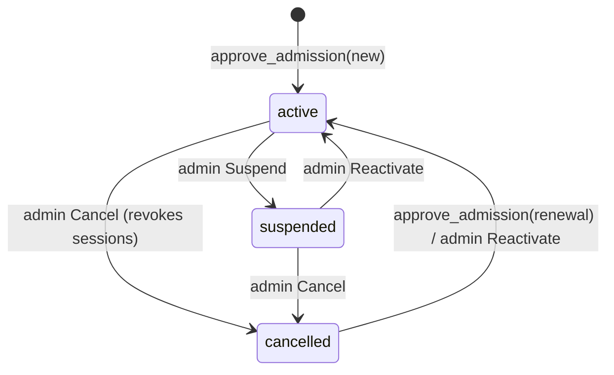
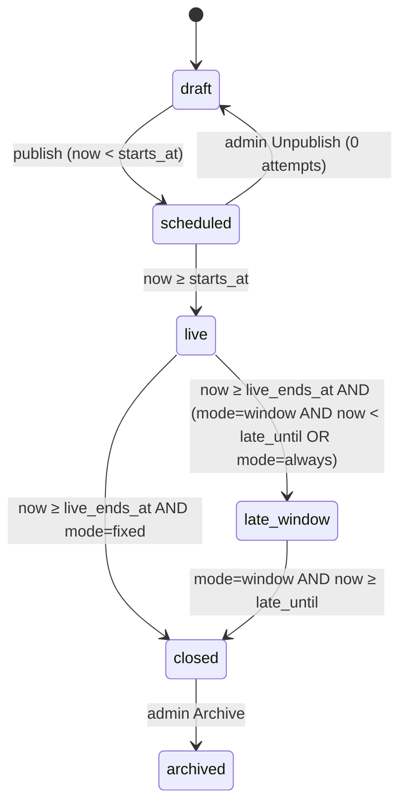
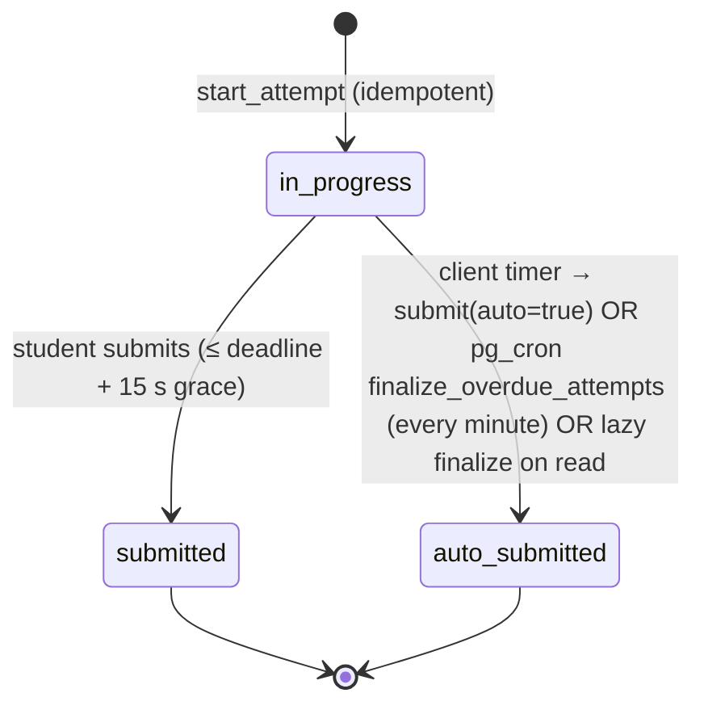

# 02 — Application Flow & State Machines

Status: **Locked for R1.** Route paths, state names and error codes here are canonical. Code must use these exact identifiers.
Cross-refs: user story IDs (`V-xx`, `S-xx`, `A-xx`) → `01_PRD.md`; tables and functions → `05_Schema.md`; components → `03_UI_Spec.md`; API contracts → `04_TRD.md` §7.

---

## 1. Route Map

Locale is **cookie-based** (`NEXT_LOCALE` = `bn` | `en`, default `bn`). URLs carry **no** locale prefix.

### 1.1 Public (no auth)
| Route | Screen | Story |
| --- | --- | --- |
| `/` | Homepage | V-01…V-04, V-08 |
| `/routine` | Exam routine (date-grouped list) | V-03 |
| `/enroll` | Enrollment / payment form (`?plan=<code>`, `?kind=renewal` from `/renew`) | V-06, V-07 |
| `/enroll/success` | Enrollment received | V-07 |
| `/sample` | Free sample exam (same exam UI, `mode="sample"`) | V-05 |
| `/sample/result` | Sample result (client-held result from `POST /api/sample/score`) | V-05 |
| `/faq` | FAQ + contact | V-04 |
| `/privacy` | Privacy policy | — |
| `/login` | Student login | S-01 |

### 1.2 Student (session cookie `bsi_session` required)
| Route | Screen | Extra guard | Story |
| --- | --- | --- | --- |
| `/change-pin` | Forced first-login PIN change | only reachable when `must_change_pin` (otherwise → `/dashboard`) | S-02 |
| `/dashboard` | Dashboard | — | S-04 |
| `/exams` | My exams list | — | S-05 |
| `/exams/[examId]` | Exam lobby (instructions + Start) | assigned to student | S-05 |
| `/attempts/[attemptId]` | Exam page (single scrolling) | owner + `in_progress` (else → result) | S-06…S-09 |
| `/attempts/[attemptId]/result` | Result & review | owner + attempt submitted | S-10, S-11 |
| `/results` | All my results | — | S-12 |
| `/profile` | Profile: mobile, email, plan, dates, theme, language, Change PIN, Logout | — | S-14, S-15 |
| `/renew` | Expired / cancelled / renewal info | — | S-13 |

**Access-state guard** (applied on `/exams/[examId]`, `/attempts/[attemptId]`, and the start/save/submit APIs): if access state ≠ `active` → redirect to `/renew` (API: `403 ACCESS_INACTIVE`). `/dashboard`, `/exams`, `/results`, `/profile`, `/renew` stay reachable. `/results` and result pages respect `results.visibleWhenInactive`.

### 1.3 Admin (session cookie `bsi_admin` required)
| Route | Screen | Story |
| --- | --- | --- |
| `/admin/login` | Admin login | A-01 |
| `/admin` | Overview dashboard | A-02 |
| `/admin/admissions` | Admissions queue (`?status=&method=&from=&to=&q=`) | A-03, A-04 |
| `/admin/students` | Students list (`?state=&label=&q=&page=`) | A-05 |
| `/admin/students/[studentId]` | Student profile + actions | A-05 |
| `/admin/questions` | Question bank list + filters | A-06, A-09 |
| `/admin/questions/new` | New question | A-07 |
| `/admin/questions/[questionId]` | Edit question | A-07 |
| `/admin/questions/import` | Bulk import | A-08 |
| `/admin/taxonomy` | Subjects / chapters / topics / tags | A-06 |
| `/admin/exams` | Exams list (`?phase=`) | A-10, A-13 |
| `/admin/exams/new` | Create exam (settings step) | A-10 |
| `/admin/exams/[examId]` | Exam builder (tabs: Settings · Questions · Audience · Publish) | A-10, A-11 |
| `/admin/exams/[examId]/preview` | Preview as student | A-11 |
| `/admin/exams/[examId]/results` | Exam results & analysis | A-12 |
| `/admin/settings` | Settings (tabs: Brand · Contact · Payments · Plans · Homepage · Policies · Integrations) | A-14, A-15 |
| `/admin/audit` | Audit log | A-16 |

### 1.4 Guard Matrix (implemented in `src/lib/auth/guards.ts`; `src/proxy.ts` only does cheap cookie-presence redirects)

| Visitor type → / Route group ↓ | No session | Student (`must_change_pin`) | Student (active) | Student (inactive) | Admin |
| --- | --- | --- | --- | --- | --- |
| Public | ✅ | ✅ (`/login` → `/change-pin`) | ✅ (`/login` → `/dashboard`) | ✅ (`/login` → `/dashboard`) | ✅ |
| Student routes | → `/login?next=<path>` | → `/change-pin` | ✅ | ✅ except exam routes → `/renew` | → `/login` (admin session ≠ student session) |
| Admin routes | → `/admin/login?next=<path>` | → `/admin/login` | → `/admin/login` | → `/admin/login` | ✅ |

`next` is accepted only if it is a relative path starting with `/` and not `//` (open-redirect protection).

---

## 2. Global Navigation & Chrome

| Context | Header | Bottom nav (mobile < 768 px) | Floating |
| --- | --- | --- | --- |
| Public | Logo (left) → `/`; right: Routine, FAQ, **Login** (text button), language toggle, theme toggle. Mobile: logo + Login + hamburger (sheet with links/toggles). | none | **Sticky Enroll bar** (mobile, hidden on `/enroll`, `/enroll/success`, `/sample*`, `/login`); WhatsApp/Messenger FAB (bottom-right, above the sticky bar) |
| Student | Logo (left) → `/dashboard`; right: Home icon → `/dashboard`, Notification icon (R1: disabled with tooltip "Coming soon"; hidden on mobile), Profile icon → `/profile` | Dashboard · Exams · Results · Profile (active tab highlighted) | none |
| Exam page | **Replaced** by the sticky exam bar (title, timer, answered counter) | **Replaced** by the sticky Submit bar | Navigator FAB, scroll-to-top FAB |
| Admin | Desktop: left sidebar (Overview, Admissions [pending badge], Students, Question Bank, Taxonomy, Exams, Settings, Audit) + top bar (brand, admin email, Logout). Mobile: top bar + hamburger drawer with the same items. | none | none |

---

## 3. State Machines

### 3.1 Admission (`admissions.status`)

- `kind` is decided **at submit time**: `renewal` if a student with that mobile exists, otherwise `new`. The admin can see it but not change it.
- Approved and rejected are terminal. A rejected TrxID **stays reserved** (the unique index covers all statuses). If the rejection was a mistake, the admin approves a fresh submission or creates a manual renewal (R1: via a student-profile "Extend" action).

### 3.2 Student account (`students.status`) and derived access state

Derived **access state** (`student_access_state()`; see `05_Schema.md` §6):

| `status` | Time check | Access state | Login allowed? | Exams allowed? |
| --- | --- | --- | --- | --- |
| suspended | — | `suspended` | ❌ "Your account is suspended. Please contact support." | ❌ |
| cancelled | — | `cancelled` | ✅ → lands on `/renew` | ❌ |
| active | now < `access_starts_at` | `expired` (shown as "Starts on <date>") | ✅ | ❌ |
| active | now ≥ `access_expires_at` | `expired` | ✅ → lands on `/renew` | ❌ |
| active | in range | `active` | ✅ | ✅ |

### 3.3 Session
`created → active → (revoked | expired)`. Revoke reasons (`sessions.revoke_reason`): `logout`, `new_login` (single-session policy), `pin_changed`, `admin_force_logout`, `admin_cancel`, `admin_suspend`, `admin_pin_reset`. A request with a revoked or expired session clears the cookie and redirects to `/login?reason=<revoke_reason>`. The login page maps the reason to a friendly banner (see §6).

### 3.4 Exam (stored `exams.status` + derived phase)
Stored: `draft → published → archived` (`published → draft` only allowed while **0 attempts** exist).
Derived phase (`exam_phase()`), evaluated at `now`:



### 3.5 Student-facing exam card status (`/dashboard`, `/exams`)
Evaluated top to bottom; the first match wins:

| # | Condition | Tag (colour) | Primary action |
| --- | --- | --- | --- |
| 1 | Attempt `submitted`/`auto_submitted` | **Completed** (green) | View result → `/attempts/:id/result` |
| 2 | Attempt `in_progress` and now < `deadline_at` | **Live Now** (red, pulsing dot) | **Resume** → `/attempts/:id` |
| 3 | Access state ≠ `active` | **Locked** (grey) | Renew → `/renew` |
| 4 | Phase `scheduled` | **Upcoming** (amber) | none (shows countdown if < 24 h) |
| 5 | Phase `live` | **Live Now** | **Start Exam** → `/exams/:id` |
| 6 | Phase `late_window` | **Missed** (red outline) + "Take Now" | **Take Now** → `/exams/:id` |
| 7 | Phase `closed` | **Missed** (red outline) | none |

An attempt that is `in_progress` past its `deadline_at` is finalized lazily on read (`finalize_attempt_if_overdue`) and then matches row 1.

### 3.6 Attempt (`exam_attempts.status`)

- `deadline_at = started_at + duration`, capped by the hard close: `fixed → live_ends_at`, `window → late_until`, `always → no cap`.
- `is_late = started_at ≥ live_ends_at`.
- Exactly one attempt per (exam, student). Start is idempotent and returns the existing attempt.

### 3.7 Exam page client state machine (`useExamSession` in `src/components/exam/`)
```mermaid
stateDiagram-v2
  [*] --> loading
  loading --> ready: paper + saved answers merged (server ∪ local, higher seq wins)
  loading --> fatal: 404/403/ATTEMPT_CLOSED → redirect (see table)
  ready --> ready: select / deselect / mark (local write → enqueue sync)
  ready --> confirming: tap Submit
  confirming --> ready: Cancel / "Review unanswered"
  confirming --> submitting: Confirm
  ready --> submitting: timer hits 0 (auto=true, no dialog)
  submitting --> submitted: 200 → clear local storage → router.replace(result)
  submitting --> submit_retry: network error (retry every 3 s with backoff, max 60 s; UI shows "Submitting… don't close this page")
  submit_retry --> submitted
  submit_retry --> submitted_server_side: 409 ATTEMPT_CLOSED (server already finalized) → go to result
```
Orthogonal **sync sub-state**: `synced | pending(n) | offline(n) | error`. The top bar shows a small cloud icon: ✓ synced, ↻ pending, ⚠ offline (a banner too).

---

## 4. Public Screens

### 4.1 Homepage `/`
Data (server-rendered, `revalidate` via tags `routine`, `settings`, `plans`): next exam, upcoming exams (next 14 days, max 10), plans, payment-free settings (brand, contact, testimonials, top performers, FAQ).

| Section (order) | Content | Actions |
| --- | --- | --- |
| 1 Hero | Headline (`home.hero.title`), value line, illustration (inline SVG, ≤ 8 KB) | **Enroll Now** → `/enroll`; **Try a Free Sample Exam** → `/sample` (hidden if no published sample exam) |
| 2 Live routine strip | "Next exam: <chapter/title>, <relative day> <time>" + countdown `DD:HH:MM:SS` | Tap → `/routine`. When the countdown hits 0 the strip shows "Live now"; if the exam is live it shows "Live now — Login to take it" → `/login`. |
| 3 Routine | Up to 10 upcoming exams grouped by date: title, chapter, time, duration, marks | **See full routine** → `/routine` |
| 4 Why join | 6 icon cards (static i18n copy) | — |
| 5 Results & social proof | Top performers, testimonials (from settings) | — |
| 6 How it works | 3 steps: Pay → Get login by email → Start exams | — |
| 7 Pricing | Active plans, sorted; highlighted plan has a "Popular" badge | **Choose** → `/enroll?plan=<code>` |
| 8 Free sample | Card with a short pitch | **Start sample** → `/sample` |
| 9 FAQ | Accordion (first 6) | **More questions** → `/faq` |
| 10 Footer | Contact, privacy, © | — |

Empty states: no upcoming exams → section 3 shows "New exams will be announced soon. Follow us on WhatsApp for updates." with the WhatsApp link; strip hidden. No testimonials → section 5 hidden. No active plans → section 7 hidden, Enroll buttons still visible.

### 4.2 Routine `/routine`
All published non-sample exams with `starts_at ≥ today 00:00 Asia/Dhaka`, grouped by date; past 7 days in a collapsible "Recent" group. Each row: time, title, chapter, duration, total marks, negative-mark note. Empty: same copy as the homepage.

### 4.3 Enroll `/enroll`
Layout (mobile, single column):
1. **Step 1 — Pay**: plan selector (radio cards; preselected from `?plan`, else the highlighted plan; the amount updates). Payment account cards (method logo, number, account type label, instructions). Each number has a **Copy** button (copied → toast "Number copied", button shows ✓ for 2 s).
2. **Step 2 — Submit details** (form):

| Field | Type | Validation (client + server, shared Zod in `src/features/admissions/schemas.ts`) | Error message key |
| --- | --- | --- | --- |
| Mobile Number | `tel`, `inputmode=numeric`, placeholder `01XXXXXXXXX` | Normalise: strip spaces/dashes, `+880` or `880` → `0`. Must match `^01[3-9]\d{8}$`. | `errors.mobileInvalid` |
| Email | `email` | RFC-lite, max 254, lower-cased | `errors.emailInvalid` |
| Payment Method | segmented control: bKash / Nagad / Rocket / Bank | required, one of the active accounts' methods | `errors.methodRequired` |
| Transaction ID | text, `autocapitalize=characters` | trim, remove spaces, 6–30 chars `[A-Za-z0-9-]` | `errors.trxInvalid` |
| Plan | hidden/radio (from Step 1) | optional active plan id | — |

Hidden fields: `kind` hint (`renewal` from `/renew`, informative only; the server decides).
Submit button: **Submit request** (loading state "Submitting…", disabled while pending).

Server responses → UI:
| Result | UI |
| --- | --- |
| ok | `router.push('/enroll/success')` |
| `TRX_DUPLICATE` | Inline error under TrxID: "This Transaction ID has already been submitted. If you think this is a mistake, contact us on WhatsApp." + WhatsApp link |
| `PENDING_EXISTS` (same mobile has a pending request) | Inline banner: "You already have a request being verified. We'll email you soon." Submission is **blocked**. |
| `VALIDATION` | Field-level errors |
| `RATE_LIMITED` (5 per IP per hour) | Banner: "Too many attempts. Please try again in a little while." |
| network/500 | Banner: "Couldn't send. Check your internet and try again." Form values preserved. |

Duplicate mobile/email of an **existing student** is **not** an error for the visitor (it becomes `kind=renewal` plus admin flags).

### 4.4 Enroll success `/enroll/success`
Check-mark illustration, confirmation copy, "What happens next" (3 bullets: we verify within ~12 h, you get an email with your PIN, log in with your mobile number). Buttons: **Try a sample exam**, **Back to home**. If reached directly without a submission it still renders (stateless).

### 4.5 Sample exam `/sample` → `/sample/result`
- `GET` the sample paper server-side (no answers). If none is published → empty state "The sample exam isn't available right now." + Enroll CTA.
- The exam UI is identical to §5.4 but: no server autosave (local only, key `bsi:sample`), the timer is client-only (duration from exam), there is no lobby, and the header shows a "Free sample" badge.
- Submit → `POST /api/sample/score` `{answers}` → response stored in `sessionStorage` → `/sample/result`, which renders the review UI (§5.5) with a sticky **Enroll Now** CTA. Rank, highest marks and option stats are hidden. Direct visit without stored data → redirect to `/sample`.

### 4.6 FAQ `/faq`
Accordion of all FAQ items from settings + a contact card (WhatsApp, Messenger, phone, email). Empty FAQ → contact card only.

### 4.7 Login `/login`
Fields: Mobile (same normalisation), PIN (`inputmode=numeric`, `type=password`, max 6, show/hide eye button), "Remember me on this device" checkbox (default **on**). Button **Log in**. Link "Forgot PIN?" → opens a sheet: "Contact us on WhatsApp to reset your PIN" + link (no self-service reset in R1).

| Server result | UI |
| --- | --- |
| ok, `must_change_pin` | → `/change-pin` |
| ok, access `active` | → `next` or `/dashboard` |
| ok, access `expired`/`cancelled` | → `/renew` |
| `INVALID_CREDENTIALS` with `attempts_left` | "Wrong PIN. {n} attempts left" (n = 5 − failures). An unknown mobile returns the **same** shape (no account enumeration): attempts counted per mobile in `rate_limit_events`. |
| `LOCKED` with `locked_until` | "Too many wrong attempts. Try again after {time}." Form disabled until then (client countdown). |
| `SUSPENDED` | "Your account is suspended. Please contact support." + WhatsApp link |
| `RATE_LIMITED` (IP: 20 per 10 min) | "Too many attempts from this network. Try again later." |

Query `?reason=` banners: `new_login` → "You were logged out because your account was used on another device."; `admin_force_logout`/`admin_cancel`/`admin_suspend` → "Your session was ended by the admin."; `pin_changed`/`admin_pin_reset` → "Your PIN was changed. Please log in again."; `expired` → "Your session expired. Please log in again."

---

## 5. Student Screens

### 5.1 Change PIN (forced) `/change-pin`
Explanation line: "For your security, set your own PIN." Fields: New PIN (4–6 digits), Confirm PIN. Validation: digits only, 4–6, match, ≠ current PIN (server checks against the hash), not in the trivial list (`0000`, `1234`, `123456`, `111111`, …; see `src/lib/auth/pin.ts`). Success → toast "PIN updated" → `/dashboard`. Other sessions are revoked (`pin_changed`); the current session is kept.

### 5.2 Dashboard `/dashboard`
| Block | Content | Empty state |
| --- | --- | --- |
| Greeting | "Welcome back" + masked mobile `017XX-XXX-890` | — |
| Subscription chip | `active`: "Active · {n} days left" (green; amber when ≤ 7 days). `expired`/`cancelled`: red chip + **Renew** button → `/renew` | — |
| Primary card | The first exam by status priority: Live Now (in-progress resume first) → Missed·Take Now → next Upcoming. Big button per §3.5. | "No exam right now. Next: {title}, {date time}" or "No upcoming exams yet." |
| Upcoming | Next 5 upcoming (title, date/time, duration) | "Nothing scheduled yet." |
| Missed | Missed exams of the last 14 days; "Take Now" when in `late_window` | hidden when empty |
| Quick stats | Exams taken, average %, best %, current streak (consecutive closed live windows attempted on time, counting back from the latest one; exams that started before the student's access began are ignored) | All zeros with hint "Take your first exam to see stats." |
| Recent results | Last 5 attempts: title, score/total, date → result | "Your results will appear here." |

### 5.3 My Exams `/exams` and Exam lobby `/exams/[examId]`
`/exams`: segmented filter **All · Live · Upcoming · Completed · Missed** (default All), list of cards (§3.5) sorted: Live, Missed-available, Upcoming (asc), Completed (desc), Missed (desc). Empty per filter: "No {filter} exams."

`/exams/[examId]` (lobby):
- Title, chapter, date/time, duration, number of questions, total marks, marks per question, **negative marking statement** (e.g., "Each wrong answer: −0.25. Skipped: 0"), access-mode note ("Late attempt: not ranked" when applicable), instructions list (auto-saves, auto-submit at time end, single attempt, don't open on two devices).
- Primary button by status: **Start Exam** (live/late_window) → `POST /api/exams/:id/start` → `router.replace('/attempts/:attemptId')`; **Resume** (in progress); **View result** (completed); disabled "Starts in {countdown}" (upcoming; becomes **Start Exam** at 0 without reload).
- Errors: `EXAM_NOT_AVAILABLE` (closed / not assigned) → "This exam is no longer available." + Back; `ACCESS_INACTIVE` → `/renew`; network → retry toast.

### 5.4 Exam page `/attempts/[attemptId]` (single scrolling page)
**Load:** server component verifies ownership and status; if `submitted`/`auto_submitted` (or overdue → finalized) → `redirect(/attempts/:id/result)`. Passes `paper` (no answers), `savedAnswers`, `deadlineAt`, `serverNow`, exam flags to the client component.

**Layout (top → bottom)**
1. **Sticky top bar** (56 px): exam title (truncated, 1 line), sync icon, **timer** `MM:SS` (or `H:MM:SS`), "Answered {x}/{n}" + 3 px progress bar at the bottom edge. Timer states: normal (> 5:00), `warning` amber (≤ 5:00), `critical` red + subtle pulse (≤ 1:00).
2. **Info strip** (scrolls away): marks, negative-marking statement, "Answers save automatically".
3. **Question cards** in `position` order (shuffled per attempt if enabled). Card: "Question {N}" label, optional ★ mark-for-review toggle (top-right, only if `allow_mark_for_review`), stem (Bangla/English + KaTeX + optional image), 4 option rows with circled letters A–D (display letters follow the displayed order; the value stored is the canonical option key).
4. End-of-paper block: "You've reached the end" + Answered summary + **Submit** button.
5. **Sticky bottom bar (mobile)**: Answered counter + **Submit** (primary). On desktop (≥ 1024 px) Submit lives in the top bar instead.
6. **Navigator FAB** (bottom-right, above the bottom bar) → bottom sheet (mobile) / right drawer (desktop) with a grid of numbers: states `unanswered` (outline), `answered` (filled primary), `marked` (amber ring + ★; combinable with answered), `current` (bold border). Legend + counts at top. Tap → smooth-scroll to the card (offset by the top bar) and close the sheet.
7. **Scroll-to-top FAB** appears after 600 px of scroll (bottom-left).

**Interactions**
| Action | Result |
| --- | --- |
| Tap an unselected option | Selects it (replaces any previous selection), card gets the `answered` state, counter +1 if previously empty, local write + sync enqueue |
| Tap the selected option | Deselects (answer = null), counter −1 |
| Tap ★ | Toggles marked |
| Keyboard (desktop) | `1–4`/`A–D` select for the focused card; `J/K` next/prev card; `M` mark; Tab order follows cards |
| Leave page / hide tab | `visibilitychange=hidden` → flush the queue with `fetch(..., {keepalive:true})` |
| Back button / close tab | `beforeunload` prompt **only** if unsynced changes exist |

**Autosave protocol** (see `04_TRD.md` §8 for details): local store `bsi:attempt:<attemptId>` = `{answers: {[qid]: {o: 'A'|null, m: bool, s: seq}}, scrollQ: n, v: 1}`; every change increments a per-attempt monotonic `seq`. The queue batches changes for 600 ms → `PUT /api/attempts/:id/answers`. Retry: 1 s, 2 s, 4 s … max 30 s, forever while `ready`. On load: merge server answers with local, taking the higher `seq` per question; push any local-newer entries immediately.

**Resume:** restores scroll to `scrollQ` (saved locally every 1 s while scrolling, and to the server with each save batch as `last_question_index`). Remaining time = `deadlineAt − (Date.now() + serverOffset)`, where `serverOffset = serverNow − clientNowAtLoad`.

**Submit dialog** (modal; bottom sheet on mobile): "Submit exam?"; counts Answered / Unanswered / Marked; buttons **Review unanswered** (only if unanswered > 0: closes and scrolls to the first unanswered question), **Cancel**, **Submit** (primary). After confirm: full-screen overlay "Submitting…".

**Auto-submit:** at `remaining ≤ 0` → overlay "Time's up! Submitting your answers…", `POST /submit {auto:true, answers: <all local entries>}`.

**Error handling**
| Situation | Behaviour |
| --- | --- |
| Offline (save fails or `navigator.onLine=false`) | Amber banner under the top bar: "You're offline. Your answers are saved on this device and will sync automatically." Exam continues normally. |
| Save `409 ATTEMPT_CLOSED` | Stop the queue → toast "Time is over" → `submitting` with auto=true (server returns the finalized attempt) → result |
| `401 SESSION_REVOKED` on save/submit | Keep local data, show a blocking modal "You've been logged out (used on another device). Log in again to continue — your answers are safe on this device." → **Log in** (`/login?next=/attempts/:id`). Local answers sync after re-login if before the deadline (grace rules apply). |
| `403 ACCESS_INACTIVE` (cancelled mid-exam) | Blocking modal "Your access has been stopped by the admin." → `/renew`. The attempt is finalized by cron at its deadline using server-saved answers. |
| Submit fails due to network | `submit_retry` overlay with spinner + "Don't close this page". After 60 s: show **Try again** button; local data kept. |
| Image fails to load | Placeholder box "Image couldn't load — tap to retry". |
| Timer reaches 0 while offline | Overlay keeps retrying submit. The server accepts the final payload up to `deadline_at + 15 s`; after that the server-side answers are final (the cron finalizes). The overlay then routes to the result on reconnect. |

### 5.5 Result & review `/attempts/[attemptId]/result`
Data from `getAttemptResult()` (see `04_TRD.md` §7.3) with visibility gates:
- `rank_visible = now ≥ coalesce(results_publish_at, submitted_at)`
- `answers_visible = now ≥ coalesce(answers_publish_at, submitted_at)`
- `stats_visible = answers_visible AND exam.show_option_stats`

| Block | Content |
| --- | --- |
| Summary card | Exam title, subject/chapter; **Marks Obtained** big figure `{score}/{total}`, colour by percentage: ≥ 80 success, ≥ 50 primary, ≥ 33 warning, < 33 danger. Under it: "Your Position: {rank}/{participants}" and "Highest Marks: {max}" **or** "Will be published after {time, date}" when `!rank_visible`. "Late attempt — not ranked" badge if late and `!rank_late_attempts`. |
| Celebration | If ≥ 80%: one-time confetti burst (CSS, ≤ 1.5 s, disabled with `prefers-reduced-motion`). |
| Analysis Report | 4 stat cards: Correct (green), Incorrect (red), Skipped (blue), Accuracy % (teal) where accuracy = correct / (correct + incorrect), "—" if both are 0. |
| Download dropdown | **Not rendered in R1** (R2). |
| Filters | Checkboxes Correct / Incorrect / Skipped (all on by default); "Showing {n} of {N}". All off → empty state "Select at least one filter." |
| Review cards | When `answers_visible`: label "Question {N}" + status tag; stem; options with ✓ green on the correct one, ✗ red on the student's wrong choice, neutral otherwise; option stats bar (A/B/C/D/Skipped %) if `stats_visible`; Solution box (soft green) with the explanation (KaTeX/images), or "No explanation provided." When `!answers_visible`: a single notice card "Answers and solutions will be available after {time, date}" with the student's own selections shown neutrally (no correctness). |
| Jump control | Navigator FAB (same component, coloured by correctness) + scroll-to-top |

Errors: not owner → 404 page; attempt still in progress → redirect to the exam page; inactive student with `results.visibleWhenInactive=false` → `/renew`.

### 5.6 Results list `/results`
Rows: title, date, `{score}/{total}`, percentage pill, Late badge → result. Sorted by `submitted_at` desc, 20 per page with "Load more". Empty: "You haven't taken any exams yet." + **Go to exams**.

### 5.7 Profile `/profile`
Read-only: mobile, email, plan, access start/expiry, access state chip. Settings: Language (বাংলা / English), Theme (System / Light / Dark). **Change PIN** (inline form: current, new, confirm → revokes other sessions). **Log out** (revokes the current session → `/login`). Note: "To change your email, contact support."

### 5.8 Renew `/renew`
- `expired`: "Your access expired on {date}. Renew to continue."
- `cancelled`: "Your access has been cancelled. Contact us or renew to continue."
- Upcoming start (`active` with a future start): "Your access starts on {date}."
- Content: plan cards → `/enroll?plan=<code>&kind=renewal` (mobile prefilled from the session via a server-rendered hidden default). **View past results** → `/results` (if allowed). WhatsApp support.
- If the student is actually `active`: show "Your subscription is active until {date}" with a renewal option (early renewal allowed).

---

## 6. Admin Screens

### 6.1 Admin login `/admin/login`
Email + password + **Log in**. Errors: `INVALID_CREDENTIALS` ("Email or password is incorrect"; no attempts-left disclosure for admins), `LOCKED` ("Locked until {time}"), `RATE_LIMITED`. Success → `next` or `/admin`.

### 6.2 Overview `/admin`
Stat tiles (each links to a filtered list): Total students, Active, Expired, Cancelled, **Pending admissions** (highlighted when > 0 → `/admin/admissions`), Revenue this month (৳), Exams this week (next 7 days from today, Dhaka). Next: "Upcoming exams" (next 5) and "Recent activity" (last 10 audit events). Empty states use neutral copy ("No pending admissions 🎉").

### 6.3 Admissions `/admin/admissions`
Table (cards on mobile): submitted time (relative), mobile, email, method badge, **TrxID** (monospace, copy button), amount/plan, kind (New/Renewal), flags (chips: "Mobile exists", "Email used by {mobile}"), actions.

| Action | Dialog / behaviour | Result |
| --- | --- | --- |
| **Approve** | Dialog: plan (select, prefilled), amount (prefilled from plan, editable), Start date (default now, or the current expiry for an active renewal), Expiry date (auto from plan duration or `fixed_expires_at`; editable), note. Confirm button **Approve & send email**. | Calls `approveAdmission`. Toast "Approved. Login details emailed to {email}." or (email failure) persistent warning toast "Approved, but the email failed. Use 'Resend credentials' on the student page." Row moves out of Pending. |
| **Reject** | Dialog: reason (select: "TrxID not found", "Amount mismatch", "Duplicate payment", "Other") + free text (required for Other). Option "Send rejection email" (default on). | Status → rejected; outbox email + sheet update. |
| Row click | Side drawer with full details, duplicate matches (links to the existing student) and the history of admissions for this mobile. | — |

Errors: `ADMISSION_NOT_PENDING` (already processed by another admin) → toast + refresh; `VALIDATION` (expiry ≤ start) → inline.
Empty (pending filter): "All caught up — no pending admissions."

### 6.4 Students `/admin/students` and `/admin/students/[studentId]`
List: search box (mobile/email, debounced 300 ms), state filter chips (All/Active/Expired/Cancelled/Suspended), label filter, columns: mobile, email, label, state chip, expiry (relative), last login, exams taken. Row checkbox → bulk bar: **Extend by N days**. Pagination 25/page.

Profile: header (mobile, email, state chip, label) + action menu:
| Action | Confirmation | Effect |
| --- | --- | --- |
| Extend validity | Number of days (preset 7/30/90 or custom) | `access_expires_at += N days` (from max(now, expiry) when expired) |
| Set expiry date | Date-time picker | Exact expiry (must be > start) |
| Cancel subscription | Type-to-confirm dialog + reason | `status=cancelled`, revoke all sessions (`admin_cancel`) |
| Suspend / Reactivate | Confirm + reason | status toggle; suspend revokes sessions |
| Reset PIN | Choice: auto-generate (default) or admin-set 4–6 digits; "Email the new PIN" (default on) | New hash, `must_change_pin=true`, revoke sessions (`admin_pin_reset`). An admin-set PIN is shown **once** in the dialog. |
| Resend credentials | Confirm "This generates a new PIN" | Same as Reset PIN (auto) + email |
| Force logout | Confirm | Revoke all sessions (`admin_force_logout`) |
| Edit | Email, label, note | Update; an email change re-syncs the Sheet row |

Tabs: **Overview** (plan, dates, credentials status, last login), **Payments** (admissions for this student), **Exams** (attempt history: exam, score, rank-at-view, late, date → admin view of the result), **Audit** (events for this student).

### 6.5 Question bank `/admin/questions`
Filter bar: subject → chapter → topic (cascading), difficulty, type, tag (multi), status (default Active+Draft), "Unused only", search (trigram on the stem). Sort: Newest / Most used / Lowest % correct. List rows: stem preview (2 lines, KaTeX rendered), chapter/topic, difficulty chip, used ×, % correct, status. Row actions: Edit, Duplicate, Archive/Unarchive. Multi-select bulk: Add tag, Remove tag, Set status. Buttons: **New question**, **Import**.
Empty: "No questions match these filters." (filters) / "Your question bank is empty. Add your first question or import a file." (no data).

### 6.6 Question editor `/admin/questions/new|[id]`
Two columns on desktop (form | live preview); on mobile a Preview toggle. Fields: chapter (required), topic (optional, creatable), stem (textarea with LaTeX hint), stem image (upload ≤ 1 MB, png/jpg/webp), options A–D (text required unless that option has an image; optional images), correct option (radio), explanation (+ image), difficulty, type, source, board year, tags (creatable combobox), status. Buttons: **Save** (stays), **Save & add another**, **Cancel**.
On save: if the `content_hash` matches another question → warning dialog "A question with the same text exists" (link) with **Save anyway** / **Cancel**. Editing a question that is used in an exam with attempts is allowed for typo fixes; the editor shows the banner "Used in {n} exams with attempts — changes affect past reviews" (correct option changes are **blocked** for such questions: `QUESTION_LOCKED_CORRECT_OPTION`).

### 6.7 Import `/admin/questions/import`
Steps: (1) **Download template** (`.xlsx` and `.csv`; columns `subject` (optional slug, default first subject), `chapter_number`, `topic` (created if missing), `stem`, `option_a`–`option_d`, `correct`, `explanation`, `difficulty`, `type`, `source`, `board_year`, `tags` (pipe-separated)) and upload (drag-drop or picker; `.csv`/`.xlsx` ≤ 5 MB, ≤ 2,000 rows) → (2) **Validation preview**: counts (valid / invalid / duplicates), a table of invalid rows with row number + column + message, and **Download error report (CSV)** → (3) choose default status for imported rows (Draft default) → **Import {n} valid questions** → (4) result: "Imported {n}. Skipped {d} duplicates, {e} invalid rows." Parsing errors (wrong headers) → step 1 error "The file's columns don't match the template."

### 6.8 Exams `/admin/exams` and builder `/admin/exams/[examId]`
List: filter by phase (Draft/Scheduled/Live/Late window/Closed/Archived), columns: title, phase chip, starts_at, questions, attempts, featured ★. Button **New exam** → `/admin/exams/new` (Settings form; Save creates a draft → builder).

Builder tabs:
1. **Settings**: all fields of PRD A-10 with defaults (duration 30, marks per question 1, negative 0, mode fixed, live_ends_at = starts_at + duration, results/answers publish defaults per §7 rule). Locked fields (once attempts exist) are disabled with a lock icon + tooltip.
2. **Questions**: left = bank browser (same filters as §6.5; questions already in the exam are marked "Added"); right = selected list with drag-handle reorder (keyboard: ↑/↓ buttons), remove ✕, running count and total marks. Only `active` questions can be added.
3. **Audience**: radio **All active students** / **Selected students** (searchable multi-select by mobile/email/label + "Add all with label X").
4. **Publish**: checklist (✔ title, ✔ ≥ 1 question, ✔ start time in the future or "publish as live now" confirm, ✔ times valid, ✔ audience non-empty), buttons **Preview as student** → `/admin/exams/:id/preview`, **Publish**, (published) **Unpublish** (only with 0 attempts), **Archive** (closed only), **Feature on homepage** toggle (unfeatures any other exam).

Publish errors map to inline checklist failures: `EXAM_INVALID_TIMES`, `EXAM_NO_QUESTIONS`, `EXAM_INACTIVE_QUESTIONS`, `EXAM_LOCKED` (edit after attempts).

**Publish-time defaults rule:** when the admin leaves results/answers publish fields empty, the server stores: `fixed → live_ends_at`, `window → late_until`, `always → NULL` (immediate).

### 6.9 Exam preview `/admin/exams/[examId]/preview`
The exam page component in `mode="preview"`: no timer countdown (shows duration), selections are local only, a banner "Preview — answers are not saved", a toggle "Show correct answers" (admin only).

### 6.10 Exam results `/admin/exams/[examId]/results`
Summary tiles: participants (+ late), average, highest, lowest. Ranked table: rank, mobile, label, score, C/I/S, late, submitted time → admin attempt view. Question analysis table: position, stem preview, % correct, most chosen wrong option, sorted by % correct asc. **Export CSV**. Empty: "No one has taken this exam yet."

### 6.11 Settings `/admin/settings`
Tabs and forms (each tab saves independently; success toast "Saved"; public pages revalidate):
- **Brand**: name, logo upload (public bucket).
- **Contact**: WhatsApp number/link, Messenger link, phone, email.
- **Payments**: CRUD list of payment accounts (method, number, label, holder, instructions bn/en, active, order).
- **Plans**: CRUD (code, names bn/en, duration days **or** fixed expiry date, price, features, highlight, active, order).
- **Homepage**: hero headline override (bn/en, optional), testimonials (text, attribution, optional photo), top performers (label, score text), FAQ items (q/a bn/en, order).
- **Policies**: max devices (1–2), past results visible when inactive (toggle).
- **Integrations**: Google Sheet status (last sync, pending/failed outbox counts), **Retry failed** button, email outbox failures list.

### 6.12 Audit `/admin/audit`
Table: time, actor (admin email / "system" / student mobile), action, entity link, summary (before→after diff for key fields). Filters: action, actor, date range, entity (student mobile). 50/page. Read-only.

---

## 7. Cross-cutting Error, Empty & Loading Rules

1. **Loading:** route-level `loading.tsx` uses skeletons matching the final layout (never a full-page spinner), except for exam submission overlays.
2. **Errors:** every route group has an `error.tsx` boundary: friendly message ("Something went wrong. Please try again.") + **Retry** + **Go home**. Errors are logged to the server console with a request id; no stack traces in the UI.
3. **404:** `not-found.tsx` with links to Home / Dashboard (if logged in).
4. **Toasts:** success 3 s, error 6 s, persistent for actions that need follow-up. Max 3 visible. `aria-live=polite`.
5. **Forms:** validate on blur and on submit; the submit button shows a spinner and is disabled while pending; server errors map to fields by `field` key; the form is never cleared on error.
6. **Destructive actions** (cancel, suspend, reset PIN, archive) always use a confirmation dialog. Cancel requires typing the student's last 3 mobile digits.
7. **Offline (non-exam pages):** a thin banner "You're offline" appears; mutations are disabled with a tooltip.
8. **API error envelope** (all route handlers and server actions): `{ ok: false, error: { code: ErrorCode, message: string (i18n key), field?: string, meta?: object } }`. Success: `{ ok: true, data }`.

### 7.1 Canonical error codes
`VALIDATION`, `UNAUTHENTICATED`, `SESSION_REVOKED`, `FORBIDDEN`, `NOT_FOUND`, `RATE_LIMITED`, `INVALID_CREDENTIALS`, `LOCKED`, `SUSPENDED`, `ACCESS_INACTIVE`, `PIN_SAME_AS_OLD`, `PIN_TOO_WEAK`, `TRX_DUPLICATE`, `PENDING_EXISTS`, `ADMISSION_NOT_PENDING`, `EXAM_NOT_AVAILABLE`, `EXAM_NOT_STARTED`, `EXAM_INVALID_TIMES`, `EXAM_NO_QUESTIONS`, `EXAM_INACTIVE_QUESTIONS`, `EXAM_LOCKED`, `ATTEMPT_CLOSED`, `QUESTION_DUPLICATE`, `QUESTION_LOCKED_CORRECT_OPTION`, `IMPORT_BAD_HEADERS`, `IMPORT_TOO_LARGE`, `INTERNAL`.

Each code has `errors.<camelCode>` keys in `messages/bn.json` and `messages/en.json`.
