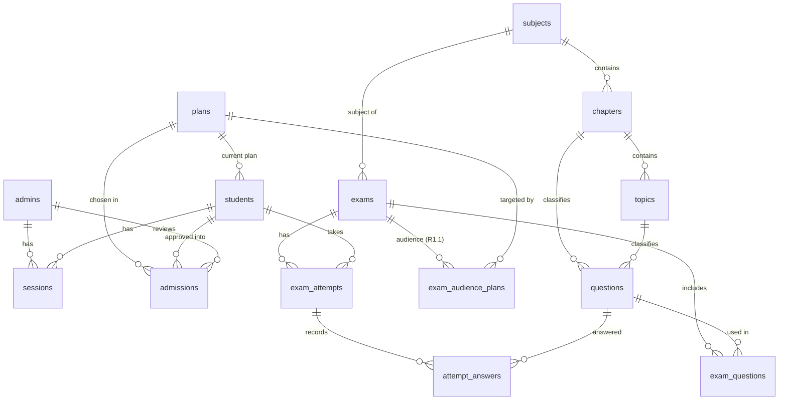

# 05 — Database Schema, RLS & Auth Flow

Status: **Locked for R1, amended by R1.1 (2026-11-09, migrations 0014–0019, `07_Plan_V2.md`).** The DDL below shows the R1.1 end state; R1-only objects are marked. Target: Supabase Postgres 17. The DDL below is normative. Migrations in `supabase/migrations/` must reproduce it exactly (split per §10). Naming: `snake_case`, plural table names, `uuid` PKs (`gen_random_uuid()`) unless noted, `timestamptz` everywhere (UTC), every mutable table has `created_at` + `updated_at` maintained by the trigger `set_updated_at()`.

---

## 1. Entity-Relationship Overview


Standalone: `payment_accounts`, `app_settings`, `rate_limit_events`, `audit_log`, `outbox`.

---

## 2. Extensions & Enums (`0001_extensions_enums.sql`)

```sql
create extension if not exists citext;
create extension if not exists pg_trgm;
create extension if not exists pgcrypto;
create extension if not exists pg_cron;   -- enabled via Supabase dashboard on hosted; schema "cron"
create extension if not exists pg_net;    -- schema "net"

create type payment_method      as enum ('bkash','nagad','rocket','bank');
create type admission_status    as enum ('pending','approved','rejected');
create type admission_kind      as enum ('new','renewal');
create type student_status      as enum ('active','suspended','cancelled');
create type credentials_status  as enum ('pending','sent','failed');
-- difficulty_level, question_type: R1 only — dropped in R1.1 (0014_v2_drop_question_meta.sql)
create type content_status      as enum ('draft','active','archived');
create type exam_status         as enum ('draft','published','archived');
create type access_mode         as enum ('fixed','window','always');
create type exam_audience       as enum ('all_active','plans');   -- R1.1 (0018); R1 had ('all_active','selected')
create type option_key          as enum ('A','B','C','D');
create type attempt_status      as enum ('in_progress','submitted','auto_submitted');
create type outbox_kind         as enum ('email_renewal','email_rejection','email_admin_alert',
                                         'sheet_admission_append','sheet_admission_update',
                                         'sheet_student_upsert','sheet_result_append');
create type outbox_status       as enum ('pending','processing','done','failed');
create type actor_type          as enum ('admin','student','system');

create or replace function set_updated_at() returns trigger language plpgsql as $$
begin new.updated_at := now(); return new; end $$;
```

---

## 3. Identity & Access Tables (`0002_identity.sql`)

```sql
create table admins (
  id              uuid primary key default gen_random_uuid(),
  email           citext not null unique,
  display_name    text   not null check (char_length(display_name) between 1 and 80),
  password_hash   text   not null,
  is_active       boolean not null default true,
  last_login_at   timestamptz,
  created_at      timestamptz not null default now(),
  updated_at      timestamptz not null default now()
);

create table students (
  id                   uuid primary key default gen_random_uuid(),
  mobile               text not null unique check (mobile ~ '^01[3-9][0-9]{8}$'),
  email                citext not null check (char_length(email) <= 254),
  pin_hash             text not null,
  must_change_pin      boolean not null default true,
  pin_updated_at       timestamptz not null default now(),
  status               student_status not null default 'active',
  access_starts_at     timestamptz not null,
  access_expires_at    timestamptz not null,
  plan_id              uuid,                                            -- FK to plans added in 0003
  credentials_status   credentials_status not null default 'pending',
  credentials_sent_at  timestamptz,
  display_name         text check (char_length(display_name) <= 40),    -- R2 (no UI in R1)
  admin_label          text check (char_length(admin_label) <= 40),
  admin_note           text check (char_length(admin_note) <= 2000),
  status_reason        text check (char_length(status_reason) <= 500),  -- last cancel/suspend reason
  status_changed_at    timestamptz,
  last_login_at        timestamptz,
  created_at           timestamptz not null default now(),
  updated_at           timestamptz not null default now(),
  constraint students_access_range check (access_expires_at > access_starts_at)
);
create index students_email_idx        on students (email);
create index students_status_exp_idx   on students (status, access_expires_at);
create index students_label_idx        on students (admin_label) where admin_label is not null;
create index students_mobile_trgm_idx  on students using gin (mobile gin_trgm_ops);

create table sessions (
  id             uuid primary key default gen_random_uuid(),
  token_hash     bytea not null unique,                 -- sha256(token)
  student_id     uuid references students(id) on delete cascade,
  admin_id       uuid references admins(id)   on delete cascade,
  remember       boolean not null default false,
  created_at     timestamptz not null default now(),
  last_seen_at   timestamptz not null default now(),
  expires_at     timestamptz not null,
  revoked_at     timestamptz,
  revoke_reason  text check (revoke_reason in ('logout','new_login','pin_changed','admin_force_logout',
                                               'admin_cancel','admin_suspend','admin_pin_reset')),
  ip             inet,
  user_agent     text check (char_length(user_agent) <= 400),
  constraint sessions_one_principal check ((student_id is null) <> (admin_id is null))
);
create index sessions_student_active_idx on sessions (student_id, created_at desc) where revoked_at is null;
create index sessions_admin_active_idx   on sessions (admin_id)                    where revoked_at is null;
create index sessions_expires_idx        on sessions (expires_at);

create table rate_limit_events (
  id          bigint generated always as identity primary key,
  bucket      text not null check (bucket in ('login_fail_mobile','login_ip','admin_login_fail',
                                              'admin_login_ip','enroll_ip','sample_ip')),
  subject     text not null,          -- normalised mobile / lower(email) / ip text
  created_at  timestamptz not null default now()
);
create index rate_limit_lookup_idx on rate_limit_events (bucket, subject, created_at desc);
```
> Migration ordering note: `plans` is referenced by `students.plan_id`. In `0002`, create `students.plan_id uuid` **without** the FK; `0003` adds `alter table students add constraint students_plan_fk foreign key (plan_id) references plans(id) on delete set null;`.

Triggers: `set_updated_at` on `admins`, `students`.

---

## 4. Commerce & Settings Tables (`0003_commerce.sql`)

```sql
create table plans (
  id                uuid primary key default gen_random_uuid(),
  code              text not null unique check (code ~ '^[a-z0-9-]{2,32}$'),   -- used in /enroll?plan=
  name_bn           text not null check (char_length(name_bn) <= 80),
  name_en           text not null check (char_length(name_en) <= 80),
  duration_days     integer check (duration_days between 1 and 1095),
  fixed_expires_at  timestamptz,                                               -- "full course" plans
  price_bdt         integer not null check (price_bdt between 0 and 1000000),
  features          jsonb not null default '[]'::jsonb,   -- [{ "bn": "...", "en": "..." }]
  is_highlighted    boolean not null default false,
  is_active         boolean not null default true,
  sort_order        integer not null default 0,
  routine_pdf_path  text,                    -- R1.1 (0017): 'plans/<uuid>.pdf' in bucket plan-routines; required on create (app rule), nullable for legacy plans
  created_at        timestamptz not null default now(),
  updated_at        timestamptz not null default now(),
  constraint plans_duration_xor check ((duration_days is null) <> (fixed_expires_at is null))
);

create table payment_accounts (
  id               uuid primary key default gen_random_uuid(),
  method           payment_method not null,
  account_number   text not null check (char_length(account_number) <= 40),
  account_label    text check (char_length(account_label) <= 40),      -- "Personal", "Merchant", "DBBL"
  account_holder   text check (char_length(account_holder) <= 80),
  instructions_bn  text check (char_length(instructions_bn) <= 1000),
  instructions_en  text check (char_length(instructions_en) <= 1000),
  is_active        boolean not null default true,
  sort_order       integer not null default 0,
  created_at       timestamptz not null default now(),
  updated_at       timestamptz not null default now()
);

create table app_settings (
  key         text primary key check (key in ('brand','contact','homepage','faq','auth','results')),
  value       jsonb not null,
  is_public   boolean not null default false,
  updated_by  uuid references admins(id) on delete set null,
  updated_at  timestamptz not null default now()
);

create table admissions (
  id                 uuid primary key default gen_random_uuid(),
  kind               admission_kind not null,
  mobile             text not null check (mobile ~ '^01[3-9][0-9]{8}$'),
  email              citext not null check (char_length(email) <= 254),
  payment_method     payment_method not null,
  trx_id             text not null check (char_length(trx_id) between 6 and 30),
  trx_id_normalized  text generated always as (upper(regexp_replace(trx_id, '[\s-]', '', 'g'))) stored,
  plan_id            uuid references plans(id) on delete set null,
  amount_bdt         integer check (amount_bdt between 0 and 1000000),   -- expected at submit; confirmed at approval
  status             admission_status not null default 'pending',
  duplicate_flags    jsonb not null default '{}'::jsonb,
      -- { "mobile_exists": bool, "email_student_mobiles": ["01…"] }  (a 2nd pending request per mobile is impossible: unique index)
  reviewed_by        uuid references admins(id) on delete set null,
  reviewed_at        timestamptz,
  reject_reason      text check (char_length(reject_reason) <= 500),
  review_note        text check (char_length(review_note) <= 1000),
  student_id         uuid references students(id) on delete set null,
  submitter_ip       inet,
  created_at         timestamptz not null default now(),
  updated_at         timestamptz not null default now(),
  constraint admissions_review_consistency check (
    (status = 'pending'  and reviewed_at is null) or
    (status = 'approved' and reviewed_at is not null and student_id is not null) or
    (status = 'rejected' and reviewed_at is not null and reject_reason is not null))
);
create unique index admissions_trx_unique_idx      on admissions (trx_id_normalized);
create unique index admissions_one_pending_mobile  on admissions (mobile) where status = 'pending';
create index admissions_status_created_idx         on admissions (status, created_at desc);
create index admissions_email_idx                  on admissions (email);
create index admissions_student_idx                on admissions (student_id);
create index admissions_reviewed_month_idx         on admissions (reviewed_at) where status = 'approved';
```

### 4.1 `app_settings` keys and JSON shapes (validated by Zod in `src/features/settings/schemas.ts`)
| key | public | shape |
| --- | --- | --- |
| `brand` | ✅ | `{ name: string, logoPath: string \| null }` |
| `contact` | ✅ | `{ whatsapp: string \| null, messenger: string \| null, phone: string \| null, email: string \| null }` |
| `homepage` | ✅ | `{ heroTitle: {bn,en} \| null, heroSubtitle: {bn,en} \| null, testimonials: [{text:{bn,en}, attribution, photoPath\|null}], topPerformers: [{label, scoreText}] }` |
| `faq` | ✅ | `[{ q:{bn,en}, a:{bn,en} }]` (ordered) |
| `auth` | ❌ | `{ maxDevices: 1 \| 2 }` |
| `results` | ❌ | `{ visibleWhenInactive: boolean }` |

Triggers: `set_updated_at` on `plans`, `payment_accounts`, `admissions`, `app_settings`.

---

## 5. Content, Exam & Attempt Tables (`0004_content.sql`, `0005_exams.sql`, `0006_attempts.sql`)

```sql
-- 0004_content.sql
create table subjects (
  id          uuid primary key default gen_random_uuid(),
  slug        text not null unique check (slug ~ '^[a-z0-9-]{2,40}$'),
  name_bn     text not null, name_en text not null,
  sort_order  integer not null default 0,
  created_at  timestamptz not null default now(), updated_at timestamptz not null default now()
);

create table chapters (
  id          uuid primary key default gen_random_uuid(),
  subject_id  uuid not null references subjects(id) on delete restrict,
  number      smallint not null check (number between 1 and 50),
  name_bn     text not null, name_en text not null,
  sort_order  integer not null default 0,
  created_at  timestamptz not null default now(), updated_at timestamptz not null default now(),
  unique (subject_id, number)
);

create table topics (
  id          uuid primary key default gen_random_uuid(),
  chapter_id  uuid not null references chapters(id) on delete restrict,
  name_bn     text not null, name_en text not null,
  sort_order  integer not null default 0,
  created_at  timestamptz not null default now(), updated_at timestamptz not null default now(),
  unique (chapter_id, name_en)
);

-- tags: R1 only — dropped in R1.1 (0014)

create table questions (
  id                      uuid primary key default gen_random_uuid(),
  chapter_id              uuid not null references chapters(id) on delete restrict,
  topic_id                uuid references topics(id) on delete set null,
  stem                    text not null check (char_length(stem) between 1 and 4000),
  stem_image_path         text,
  option_a                text not null default '' check (char_length(option_a) <= 1000),
  option_a_image_path     text,
  option_b                text not null default '' check (char_length(option_b) <= 1000),
  option_b_image_path     text,
  option_c                text not null default '' check (char_length(option_c) <= 1000),
  option_c_image_path     text,
  option_d                text not null default '' check (char_length(option_d) <= 1000),
  option_d_image_path     text,
  correct_option          option_key not null,
  explanation             text check (char_length(explanation) <= 8000),
  explanation_image_path  text,
  -- difficulty, qtype, source, board_year: R1 only — dropped in R1.1 (0014)
  status                  content_status not null default 'draft',
  content_hash            text not null,          -- set by trigger, see below
  times_used              integer not null default 0,   -- # exams with ≥1 final attempt that include it
  times_answered          integer not null default 0,   -- # final attempts where it was answered (non-null)
  times_correct           integer not null default 0,
  created_by              uuid references admins(id) on delete set null,
  updated_by              uuid references admins(id) on delete set null,
  deleted_at              timestamptz,             -- R1.1 (0015): soft delete (used in past exams); hidden from bank/builder/search/duplicates
  deleted_by              uuid references admins(id) on delete set null,   -- R1.1 (0015)
  created_at              timestamptz not null default now(),
  updated_at              timestamptz not null default now(),
  constraint questions_options_present check (
    (option_a <> '' or option_a_image_path is not null) and (option_b <> '' or option_b_image_path is not null) and
    (option_c <> '' or option_c_image_path is not null) and (option_d <> '' or option_d_image_path is not null))
);
create index questions_chapter_status_idx on questions (chapter_id, status);
create index questions_topic_idx          on questions (topic_id);
create index questions_live_idx           on questions (chapter_id, status) where deleted_at is null;   -- R1.1 (0015)
create index questions_hash_idx           on questions (content_hash);
create index questions_stem_trgm_idx      on questions using gin (stem gin_trgm_ops);
create index questions_created_idx        on questions (created_at desc);

-- question_tags: R1 only — dropped in R1.1 (0014)

-- content_hash: sha256 of stem + options, EACH lower-cased, whitespace-collapsed and trimmed, joined by '|' (hex).
create or replace function questions_set_hash() returns trigger language plpgsql as $$
declare norm text;
begin
  norm := lower(regexp_replace(concat_ws('|', new.stem, new.option_a, new.option_b, new.option_c, new.option_d),
                               '\s+', ' ', 'g'));
  new.content_hash := encode(digest(trim(norm), 'sha256'), 'hex');
  return new;
end $$;
create trigger questions_hash_trg before insert or update of stem, option_a, option_b, option_c, option_d
  on questions for each row execute function questions_set_hash();
-- topic must belong to chapter
create or replace function questions_check_topic() returns trigger language plpgsql as $$
begin
  if new.topic_id is not null and not exists
     (select 1 from topics t where t.id = new.topic_id and t.chapter_id = new.chapter_id) then
    raise exception 'TOPIC_CHAPTER_MISMATCH' using errcode = 'P0001';
  end if; return new;
end $$;
create trigger questions_topic_trg before insert or update of topic_id, chapter_id
  on questions for each row execute function questions_check_topic();
```

```sql
-- 0005_exams.sql
create table exams (
  id                     uuid primary key default gen_random_uuid(),
  title                  text not null check (char_length(title) between 1 and 120),
  description            text check (char_length(description) <= 2000),
  subject_id             uuid references subjects(id) on delete set null,
  chapter_label          text check (char_length(chapter_label) <= 80),   -- display text e.g. "Chapter 3"
  status                 exam_status not null default 'draft',
  is_sample              boolean not null default false,
  -- is_featured: R1 only — dropped in R1.1 (0019) with index exams_one_featured
  starts_at              timestamptz,                -- required to publish (non-sample)
  live_ends_at           timestamptz,                -- default starts_at + duration
  access_mode            access_mode not null default 'fixed',
  late_until             timestamptz,                -- required iff access_mode = 'window'
  duration_minutes       integer not null default 30 check (duration_minutes between 1 and 300),
  marks_per_question     numeric(5,2) not null default 1 check (marks_per_question > 0),
  negative_mark          numeric(5,2) not null default 0 check (negative_mark >= 0),
  shuffle_questions      boolean not null default false,
  shuffle_options        boolean not null default false,
  allow_mark_for_review  boolean not null default true,
  results_publish_at     timestamptz,                -- rank + highest; NULL = immediately after own submit
  answers_publish_at     timestamptz,                -- correct answers + solutions; NULL = immediately
  show_option_stats      boolean not null default true,
  rank_late_attempts     boolean not null default false,
  audience               exam_audience not null default 'all_active',
  question_count         integer not null default 0,  -- maintained by trigger on exam_questions
  published_at           timestamptz,
  created_by             uuid references admins(id) on delete set null,
  created_at             timestamptz not null default now(),
  updated_at             timestamptz not null default now(),
  constraint exams_times check (live_ends_at is null or starts_at is null or live_ends_at > starts_at),
  constraint exams_window check (
    (access_mode = 'window' and late_until is not null and live_ends_at is not null and late_until > live_ends_at)
    or (access_mode <> 'window' and late_until is null)),
  constraint exams_published_has_times check (status = 'draft' or is_sample or (starts_at is not null and live_ends_at is not null))
);
create unique index exams_one_sample   on exams (is_sample) where is_sample and status = 'published';
create index exams_status_starts_idx   on exams (status, starts_at);

create table exam_questions (
  exam_id      uuid not null references exams(id) on delete cascade,
  question_id  uuid not null references questions(id) on delete restrict,
  position     integer not null check (position >= 1),
  primary key (exam_id, question_id),
  unique (exam_id, position) deferrable initially deferred
);
create index exam_questions_question_idx on exam_questions (question_id);

-- exam_assignees ("selected students" audience): R1 only — dropped in R1.1 (0018)

-- R1.1 (0018): an exam with audience = 'plans' is visible to students whose current plan is listed here.
create table exam_audience_plans (
  exam_id  uuid not null references exams(id) on delete cascade,
  plan_id  uuid not null references plans(id) on delete restrict,
  primary key (exam_id, plan_id)
);
create index exam_audience_plans_plan_idx on exam_audience_plans (plan_id);
```
Triggers on exams/exam_questions:
- `exam_questions_count_trg` (after insert/delete) → recompute `exams.question_count`.
- Lock triggers (defined in `0006` because they reference `exam_attempts`): `exam_questions_lock_trg` (before insert/update/delete on `exam_questions`) and `exams_lock_trg` (before update on `exams` when `marks_per_question`, `negative_mark`, `shuffle_questions`, `shuffle_options` or `duration_minutes` change, or status goes `published → draft`) → `raise exception 'EXAM_LOCKED'` if any attempt exists.
- `set_updated_at` on `exams`.

```sql
-- 0006_attempts.sql
create table exam_attempts (
  id                 uuid primary key default gen_random_uuid(),
  exam_id            uuid not null references exams(id) on delete restrict,
  student_id         uuid not null references students(id) on delete cascade,
  status             attempt_status not null default 'in_progress',
  started_at         timestamptz not null default now(),
  deadline_at        timestamptz not null,
  submitted_at       timestamptz,
  is_late            boolean not null default false,
  question_order     uuid[] not null,                 -- display order of question ids
  option_order       jsonb  not null default '{}',    -- { "<question_id>": "CABD" } (display → canonical)
  score              numeric(7,2),
  correct_count      integer,
  incorrect_count    integer,
  skipped_count      integer,
  last_question_index integer not null default 0,
  tab_switch_count   integer not null default 0,      -- R2 (unused in R1)
  created_at         timestamptz not null default now(),
  updated_at         timestamptz not null default now(),
  unique (exam_id, student_id),
  constraint attempts_final_consistency check (
    (status = 'in_progress' and submitted_at is null and score is null) or
    (status <> 'in_progress' and submitted_at is not null and score is not null))
);
create index attempts_exam_rank_idx     on exam_attempts (exam_id, score desc) where status <> 'in_progress';
create index attempts_student_idx       on exam_attempts (student_id, started_at desc);
create index attempts_overdue_idx       on exam_attempts (deadline_at) where status = 'in_progress';

create table attempt_answers (
  attempt_id       uuid not null references exam_attempts(id) on delete cascade,
  question_id      uuid not null references questions(id) on delete restrict,
  selected_option  option_key,                -- null = cleared/skipped
  is_marked        boolean not null default false,
  client_seq       bigint not null default 0,
  is_correct       boolean,                   -- set at scoring; null while in progress or when skipped
  updated_at       timestamptz not null default now(),
  primary key (attempt_id, question_id)
);
create index attempt_answers_question_idx on attempt_answers (question_id) include (selected_option);
```

---

## 6. Ops Tables (`0007_ops.sql`)

```sql
create table audit_log (
  id                bigint generated always as identity primary key,
  actor_type        actor_type not null,
  actor_admin_id    uuid references admins(id)   on delete set null,
  actor_student_id  uuid references students(id) on delete set null,
  action            text not null,      -- see list below
  entity_type       text not null check (entity_type in ('admission','student','exam','question','setting','plan','payment_account','session')),
  entity_id         text,
  before            jsonb,
  after             jsonb,
  meta              jsonb not null default '{}',
  created_at        timestamptz not null default now()
);
create index audit_entity_idx  on audit_log (entity_type, entity_id, created_at desc);
create index audit_created_idx on audit_log (created_at desc);
create index audit_action_idx  on audit_log (action, created_at desc);
-- append-only; the single permitted change is ON DELETE SET NULL of actor_admin_id / actor_student_id
-- (otherwise deleting a student or admin with audit rows would be impossible). See 0007_ops.sql.
create or replace function audit_log_immutable() returns trigger language plpgsql as $$ … $$;
create trigger audit_log_no_update before update or delete on audit_log
  for each row execute function audit_log_immutable();

create table outbox (
  id               bigint generated always as identity primary key,
  kind             outbox_kind not null,
  payload          jsonb not null,           -- NEVER contains PINs/passwords/tokens
  dedupe_key       text unique,              -- e.g. 'sheet_result_append:<attempt_id>'
  status           outbox_status not null default 'pending',
  attempts         smallint not null default 0,
  max_attempts     smallint not null default 8,
  next_attempt_at  timestamptz not null default now(),
  locked_at        timestamptz,
  last_error       text,
  created_at       timestamptz not null default now(),
  done_at          timestamptz
);
create index outbox_ready_idx on outbox (next_attempt_at, id) where status in ('pending','processing');
```

**Audit actions (canonical):** `admission.approve`, `admission.reject`, `student.extend`, `student.set_expiry`, `student.cancel`, `student.suspend`, `student.reactivate`, `student.pin_reset`, `student.credentials_resend`, `student.credentials_email_failed`, `student.force_logout`, `student.update`, `student.pin_changed_by_student`, `exam.create`, `exam.publish`, `exam.unpublish`, `exam.archive`, `question.import`, `question.delete` (R1.1; meta `{mode: 'soft'|'hard'}`; `exam.feature` was R1 only), `setting.update`, `plan.upsert`, `payment_account.upsert`.

---

## 7. Row-Level Security & Grants (`0008_rls.sql`)

**Model (ADR-03):** the app server uses `service_role` (bypasses RLS). The `anon` role (public anon key) gets read access only to non-sensitive public data. The `authenticated` role is **unused** (no Supabase Auth) and gets nothing.

```sql
-- 1) Enable RLS on every table (and force it, so even table owners obey policies in SQL tests)
do $$ declare t record; begin
  for t in select tablename from pg_tables where schemaname = 'public' loop
    execute format('alter table public.%I enable row level security', t.tablename);
    execute format('alter table public.%I force row level security', t.tablename);
  end loop; end $$;

-- 2) Revoke everything from client roles, then grant narrowly
revoke all on all tables    in schema public from anon, authenticated;
revoke all on all sequences in schema public from anon, authenticated;
revoke all on all functions in schema public from anon, authenticated, public;
alter default privileges in schema public revoke all on tables    from anon, authenticated;
alter default privileges in schema public revoke all on functions from anon, authenticated, public;

-- 3) Public read surface (anon only)
grant select on plans to anon;
create policy plans_public_read on plans for select to anon using (is_active);

grant select on payment_accounts to anon;
create policy payment_accounts_public_read on payment_accounts for select to anon using (is_active);

grant select (key, value) on app_settings to anon;
create policy app_settings_public_read on app_settings for select to anon using (is_public);

grant select on subjects, chapters to anon;
create policy subjects_public_read on subjects for select to anon using (true);
create policy chapters_public_read on chapters for select to anon using (true);

-- exams: R1 granted anon a column-level select + policy exams_public_routine for the public routine.
-- R1.1 (0019) revokes both: visitors never read exam data (routine is per plan PDF; students read via the server).

-- 4) No policies on: admins, students, sessions, rate_limit_events, admissions, topics, questions,
--    exams (R1.1), exam_questions, exam_audience_plans, exam_attempts, attempt_answers, audit_log, outbox,
--    question_import_batches
--    → fully denied to anon/authenticated.

-- 5) Functions: EXECUTE for service_role only (repeat for each function in §8)
grant execute on function start_attempt(uuid, uuid) to service_role;
-- … (one grant line per function)
```
Storage policies: bucket `question-media` has **no** policies for anon/authenticated (service_role signs URLs). Bucket `public-assets` is public-read; writes service_role only. R1.1: bucket `plan-routines` is public-read (`application/pdf`, 5 MB limit), writes only through service-role signed upload URLs; bucket `import-uploads` is private with no anon/authenticated policies (20 MB limit).

**pgTAP tests required** (`supabase/tests/rls.test.sql`): RLS enabled on all public tables; `anon` cannot select from `questions`, `students`, `admissions`, `exam_attempts`, `attempt_answers`, `sessions`; `anon` cannot select from `exams` (R1.1; R1 allowed published exams on granted columns); `anon` cannot execute any public function.

### 7.1 Auth flow (end-to-end)

```
STUDENT LOGIN (Server Action studentLogin)
 1. Zod-parse {mobile,pin,remember}; normalise mobile.
 2. rate_limit: count(login_ip, ip, 10 min) ≥ 20 → RATE_LIMITED. Insert login_ip event.
 3. failures = count(login_fail_mobile, mobile, 15 min); ≥ 5 → LOCKED (locked_until = 5th newest + 15 min).
 4. select student by mobile (service_role). If none → argon2.verify(DUMMY_HASH) → step 6.
 5. If status = 'suspended' → SUSPENDED (checked AFTER a correct PIN only, to avoid status enumeration).
 6. verify(pin_hash, pin + pepper). Fail → insert login_fail_mobile event → INVALID_CREDENTIALS {attempts_left}.
 7. Success → delete login_fail_mobile events for mobile; token = randomBytes(32);
    insert sessions(token_hash=sha256(token), student_id, remember, expires_at, ip, ua);
    revoke older active sessions beyond auth.maxDevices with reason 'new_login';
    update students.last_login_at; queue sheet_student_upsert (Last Login) — debounced to max 1/day/student.
 8. Set cookie bsi_session; redirect per access state (02_AppFlow §4.7).

REQUEST AUTH (requireStudent / requireActiveStudent)
 1. Read cookie → sha256 → select sessions s join students st on s.student_id = st.id
    where token_hash = $1 and revoked_at is null and expires_at > now().
 2. None → clear cookie → /login?reason=<revoke_reason|expired> (API: 401 SESSION_REVOKED / UNAUTHENTICATED).
 3. st.status = 'suspended' → revoke session (admin_suspend) → /login?reason=admin_suspend.
 4. must_change_pin and route ≠ /change-pin → /change-pin.
 5. requireActiveStudent additionally: student_access_state(st) ≠ 'active' → /renew (API 403 ACCESS_INACTIVE).
 6. Touch last_seen_at if > 5 min old; admin sessions also slide expires_at.

ADMIN LOGIN mirrors steps 1–8 using admins, buckets admin_login_ip / admin_login_fail, cookie bsi_admin,
no attempts_left disclosure, no single-session policy.

APPROVAL → CREDENTIALS
 Server: pin = generatePin(); hash = argon2(pin) → rpc approve_admission(..., p_pin_hash := hash)
 → commit → after(): send credentials email with pin (memory only) → set credentials_status sent|failed.
```

---

## 8. Functions, Views & Jobs (`0009`–`0012`)

All functions: `language plpgsql` (or `sql`), `security definer`, `set search_path = public, pg_temp` (functions that use `citext`/`digest` add `extensions`: `public, extensions, pg_temp`), EXECUTE revoked from `public/anon/authenticated`, granted to `service_role`. Errors are raised as `raise exception '<ERROR_CODE>' using errcode = 'P0001'`; the app maps the message to the `ErrorCode` union (`04_TRD.md`).

### 8.1 Derived state (`0009_derived.sql`)
| Function | Signature | Logic |
| --- | --- | --- |
| `student_access_state` | `(s students, at timestamptz default now()) returns text` (immutable-ish, `stable`) | `suspended` if status='suspended'; `cancelled` if 'cancelled'; `expired` if `at < access_starts_at or at >= access_expires_at`; else `active`. |
| `exam_phase` | `(e exams, at timestamptz default now()) returns text` | `archived` / `draft` by status; sample exams → `live`; `scheduled` if `at < starts_at`; `live` if `at < live_ends_at`; `late_window` if (`window` and `at < late_until`) or `always`; else `closed`. |
| `student_is_assigned` | `(p_exam exams, p_student_id uuid) returns boolean` | R1.1: `audience='all_active'` → true; `audience='plans'` → exists in `exam_audience_plans` with the student's current `plan_id` (null plan → false). (R1: `selected` → exists in `exam_assignees`.) |
| `student_exam_cards` | `(p_student_id uuid) returns table(exam_id, title, chapter_label, starts_at, live_ends_at, late_until, duration_minutes, question_count, total_marks, phase, card_status, attempt_id, attempt_status, score)` | Published non-sample exams assigned to the student; `card_status` per `02_AppFlow.md` §3.5 (`completed`, `in_progress`, `locked`, `upcoming`, `live`, `missed_available`, `missed`). Calls `finalize_attempt_if_overdue` for overdue attempts first. |

**View** `paper_questions` (no answers):
```sql
create view paper_questions with (security_invoker = true) as
select id, stem, stem_image_path, option_a, option_a_image_path, option_b, option_b_image_path,
       option_c, option_c_image_path, option_d, option_d_image_path
from questions;
revoke all on paper_questions from anon, authenticated;
```

### 8.2 Attempts (`0010_attempts_fn.sql`)
| Function | Signature | Behaviour |
| --- | --- | --- |
| `start_attempt` | `(p_exam_id uuid, p_student_id uuid) returns uuid` | Lock the student row (`for share`); require `student_access_state = 'active'` (`ACCESS_INACTIVE`); exam published, not sample, assigned (`EXAM_NOT_AVAILABLE`); phase `scheduled` → `EXAM_NOT_STARTED`; phase not in (`live`,`late_window`) → `EXAM_NOT_AVAILABLE`. Return the existing attempt id if any (even if final). Else insert: `question_order` = positions (or `random()` order if shuffle); `option_order` = per question `'ABCD'` or a random permutation if shuffle_options; `deadline_at = least(now() + duration, cap)` with cap = `live_ends_at` (fixed) / `late_until` (window) / none (always); `is_late = now() >= live_ends_at`. `on conflict (exam_id, student_id) do nothing` then re-select. |
| `random_option_order` | `() returns text` (volatile) | Random permutation of `ABCD`, evaluated per row. |
| `apply_answer_changes` | `(p_attempt exam_attempts, p_changes jsonb) returns int` (internal) | Dedupes by question (highest seq), ignores questions not in `question_order`, upserts `where stored.client_seq < excluded.client_seq`. Used by save and submit. |
| `save_answers` | `(p_attempt_id uuid, p_student_id uuid, p_changes jsonb, p_last_index int default null) returns int` | `select … for update`; owner check (`NOT_FOUND`); status in_progress and `now() <= deadline_at + interval '15 seconds'` else `ATTEMPT_CLOSED`; ignore changes whose `q` is not in `question_order`; upsert into `attempt_answers` with `where attempt_answers.client_seq < excluded.client_seq`; update `last_question_index`; return the number of rows applied. |
| `submit_attempt` | `(p_attempt_id uuid, p_student_id uuid, p_changes jsonb, p_auto boolean) returns uuid` | Lock; owner check; if final → `ATTEMPT_CLOSED`. Apply `p_changes` only if `now() <= deadline_at + 15 s`. Then `perform score_attempt(p_attempt_id, case when p_auto or now() > deadline_at then 'auto_submitted' else 'submitted' end)`. Return the attempt id. |
| `score_attempt` | `(p_attempt_id uuid, p_final attempt_status) returns void` (internal) | Set `is_correct` on answers (joined to `questions.correct_option`); counts: correct, incorrect (non-null wrong), skipped = question_count − answered; `score = round(correct*mpq − incorrect*neg, 2)`; set status, `submitted_at = least(now(), deadline_at + 15 s)`; update `questions.times_answered/times_correct`; `times_used` += 1 for each question when this is the exam's first final attempt; insert outbox `sheet_result_append` (dedupe `sheet_result_append:<attempt_id>`). |
| `finalize_attempt_if_overdue` | `(p_attempt_id uuid) returns void` | If in_progress and `now() > deadline_at + 15 s` → `score_attempt(…, 'auto_submitted')`. |
| `finalize_overdue_attempts` | `() returns int` | Loop over `in_progress` attempts with `deadline_at + 15 s < now()` (`for update skip locked`, limit 500) → `score_attempt`. |

### 8.3 Results (`0011_results_admissions_fn.sql`)
| Function | Signature | Behaviour |
| --- | --- | --- |
| `attempt_rank` | `(p_attempt_id uuid) returns table(rank_position int, participants int, highest numeric)` | Over final attempts of the same exam, excluding late attempts unless `rank_late_attempts`; `rank_position = 1 + count(score > mine)` (competition ranking); a non-ranked late attempt returns `rank_position = null`. |
| `exam_question_stats` | `(p_exam_id uuid) returns table(question_id uuid, total int, a int, b int, c int, d int, skipped int, correct_pct numeric)` | From final attempts; skipped = total − answered. |
| `exam_summary` | `(p_exam_id uuid) returns table(participants, late_participants, avg_score, max_score, min_score)` | Admin results. |

### 8.4 Admissions, students, sessions, outbox (`0011_results_admissions_fn.sql`)
| Function | Signature | Behaviour |
| --- | --- | --- |
| `submit_admission` | `(p_mobile text, p_email citext, p_method payment_method, p_trx text, p_plan_id uuid, p_ip inet) returns uuid` | Determine `kind` (student with mobile exists → renewal); compute `duplicate_flags`; `amount_bdt` from the plan; insert (unique violations → `TRX_DUPLICATE` / `PENDING_EXISTS`); enqueue `sheet_admission_append` + `email_admin_alert`. |
| `approve_admission` | `(p_admission_id uuid, p_admin_id uuid, p_plan_id uuid, p_amount_bdt int, p_starts_at timestamptz, p_expires_at timestamptz, p_pin_hash text, p_note text) returns table(student_id uuid, kind admission_kind, email citext, mobile text)` | Lock the admission; must be pending (`ADMISSION_NOT_PENDING`). **new:** insert the student (`pin_hash = p_pin_hash`, `must_change_pin = true`, `credentials_status='pending'`). If a student with that mobile was created meanwhile, treat it as a renewal. **renewal:** update the existing student: `access_starts_at` kept unless expired/cancelled (then `p_starts_at`), `access_expires_at = p_expires_at`, `status = 'active'` (if cancelled), `plan_id`, email updated to the admission email. Set the admission approved; audit `admission.approve`; enqueue `sheet_admission_update`, `sheet_student_upsert`, and (renewal) `email_renewal`. `p_pin_hash` is ignored for renewals. |
| `reject_admission` | `(p_admission_id uuid, p_admin_id uuid, p_reason text, p_send_email boolean) returns void` | Pending check; update; audit; enqueue `sheet_admission_update` (+ `email_rejection`). |
| `admin_update_student_access` | `(p_admin_id uuid, p_student_ids uuid[], p_op text, p_days int, p_expires_at timestamptz, p_reason text) returns int` | `p_op` ∈ `extend`, `set_expiry`, `cancel`, `suspend`, `reactivate`. `extend`: `access_expires_at = greatest(access_expires_at, now()) + p_days`. `cancel`/`suspend`: revoke all sessions (reason `admin_cancel`/`admin_suspend`). One audit row per student with before/after; enqueue `sheet_student_upsert`. |
| `admin_set_student_pin` | `(p_admin_id uuid, p_student_id uuid, p_pin_hash text, p_action text) returns void` | `pin_hash`, `must_change_pin=true`, `pin_updated_at`, `credentials_status='pending'`; revoke sessions (`admin_pin_reset`); audit `student.pin_reset` or `student.credentials_resend`. |
| `revoke_sessions` | `(p_reason text, p_student_id uuid default null, p_admin_id uuid default null, p_except_session uuid default null) returns int` | Exactly one of student/admin; sets `revoked_at`, `revoke_reason`. |
| `enforce_session_limit` | `(p_student_id uuid, p_max int) returns int` | Keeps the newest `p_max` active sessions, revokes the rest with `new_login` (single-session policy). |
| `log_audit` | `(p_actor actor_type, p_action text, p_entity_type text, p_entity_id text default null, p_admin uuid default null, p_student uuid default null, p_before jsonb default null, p_after jsonb default null, p_meta jsonb default '{}') returns void` | Insert helper. |
| `log_audit_admin` | `(p_admin uuid, p_action text, p_entity_type text, p_entity_id text, p_before jsonb default null, p_after jsonb default null, p_meta jsonb default '{}') returns void` | Shorthand used inside admin SQL functions. |
| `claim_outbox` | `(p_limit int, p_kinds outbox_kind[]) returns setof outbox` | `update … set status='processing', locked_at=now(), attempts=attempts+1 where id in (select id … where status='pending' and next_attempt_at <= now() or (status='processing' and locked_at < now()-interval '5 min') order by id for update skip locked limit p_limit) returning *`. |
| `complete_outbox` | `(p_id bigint, p_ok boolean, p_error text) returns void` | ok → done; else backoff `next_attempt_at = now() + (array['1m','5m','15m','1h','3h','6h','12h','24h'])[attempts]::interval`, failed when `attempts >= max_attempts`. |

### 8.5 Scheduled jobs (`0012_cron.sql`)
```sql
select cron.schedule('finalize-overdue-attempts', '* * * * *',  $$select public.finalize_overdue_attempts()$$);
-- kick_outbox(): no-op unless Vault secrets exist AND due outbox work exists; then net.http_post to
-- <site_url>/api/internal/outbox/drain with header x-cron-secret.
select cron.schedule('outbox-kick',              '*/2 * * * *', $$select public.kick_outbox()$$);
select cron.schedule('cleanup-daily', '30 20 * * *',  -- 02:30 Asia/Dhaka
  $$delete from public.rate_limit_events where created_at < now() - interval '2 days';
    delete from public.sessions where expires_at < now() - interval '30 days';
    delete from public.outbox where status = 'done' and done_at < now() - interval '30 days';$$);
```
R1.1 (`0016_v2_import_uploads.sql`): `stale_import_uploads(p_older_than interval, p_limit int default 1000) returns table(bucket_id, name)` lists objects in `import-uploads` and `question-media/staging/` older than the interval (read-only on `storage.objects`); `kick_import_cleanup()` (same no-op rules as `kick_outbox`) posts to `<site_url>/api/internal/imports/cleanup` when 24 h-old staged files exist; `select cron.schedule('import-cleanup-kick', '20 * * * *', $$select public.kick_import_cleanup()$$);`. The route deletes through the Storage API.

Vault secrets `site_url` and `cron_secret` are created manually per environment (documented in the runbook; local dev sets them in `seed.sql`).

---

### 8.6 Phase 2 support (`0013_phase2_support.sql`)
| Object | Definition |
| --- | --- |
| `question_content_hash(stem, a, b, c, d) returns text` (immutable) | Single normalisation (each field lower-cased, whitespace-collapsed, trimmed; joined by `|`; sha256 hex). Used by the `questions_set_hash` trigger. `questions.content_hash` defaults to `''` and is always overwritten. |
| `content_hashes(p_items jsonb) returns table(idx int, hash text)` | Batch hashing for import previews (`[{stem,a,b,c,d}]`). |
| `questions.correct_rate numeric` (generated, stored) | `times_correct / times_answered` (4 dp), null when unanswered; indexed for "lowest % correct". |
| trigger `questions_lock_correct_option_trg` | `QUESTION_LOCKED_CORRECT_OPTION` when `correct_option` changes and the question is in any exam with attempts. |
| table `question_import_batches(id, admin_id → admins, rows jsonb, summary jsonb, created_at, expires_at = now()+30 min; R1.1 adds images jsonb, staged_paths text[])` | Validated import rows awaiting commit; RLS forced, service_role only; cron `cleanup-import-batches` every 30 min. |
| `set_exam_questions(p_exam_id, p_question_ids uuid[]) returns int` | Atomic replace in order, de-duplicated; `EXAM_INACTIVE_QUESTIONS` unless all exist and are active; lock trigger applies. |
| `set_exam_audience(p_exam_id, p_audience, p_plan_ids uuid[]) returns int` | R1.1 (0018): sets audience; replaces `exam_audience_plans` (existing plans only) when `plans`, clears them for `all_active`. (R1 signature took `p_student_ids`.) |
| ~~`set_question_tags`~~ | R1 only — dropped in R1.1 (0014). |

### 8.7 R1.1 functions (`0015_v2_question_delete.sql`)
| Function | Signature | Behaviour |
| --- | --- | --- |
| `delete_questions` | `(p_admin uuid, p_ids uuid[]) returns table(question_id uuid, mode text, image_paths text[])` | Raises `QUESTION_IN_USE` (detail: JSON list of blocking exam ids/titles) if any id is in `exam_questions` of an exam whose `exam_phase` is `draft`, `scheduled`, `live` or `late_window`; nothing is changed then. Otherwise per question: referenced by any `exam_questions` or `attempt_answers` row → set `deleted_at = now()`, `deleted_by = p_admin` (`mode='soft'`); unreferenced → delete the row (`mode='hard'`, returns its stem/option/explanation image paths for Storage cleanup). One `log_audit_admin(p_admin, 'question.delete', 'question', id, before, null, {mode})` per question. `set_exam_questions` rejects soft-deleted ids (`EXAM_INACTIVE_QUESTIONS`). |

## 9. Seed Data (`supabase/seed.sql`, local/dev only)
- Subject `ict` (তথ্য ও যোগাযোগ প্রযুক্তি / ICT) with HSC chapters: 1 ICT: World & Bangladesh Perspective · 2 Communication Systems & Networking · 3 Number Systems & Digital Devices · 4 Introduction to Web Design & HTML · 5 Programming Language · 6 Database Management System. 2–3 topics each (e.g., Ch 3: Binary Conversion, Logic Gates, Boolean Algebra).
- 3 plans: `1-month` (30 days, ৳500), `3-months` (90 days, ৳1,200, highlighted), `full-course` (fixed expiry, ৳2,500).
- 3 payment accounts (bKash, Nagad, Rocket) with placeholder numbers `01XXXXXXXXX`.
- `app_settings` rows for every key with sensible defaults (`auth.maxDevices=1`, `results.visibleWhenInactive=true`).
- 40 active questions across chapters (Bangla and English mix, ≥ 5 with LaTeX, code snippets). R1.1: no tags/difficulty/type/source/board year; seed exams use `audience = 'all_active'`; plans have no routine PDF (Storage objects cannot be created from SQL). No images: Storage objects cannot be created from SQL; image fixtures are uploaded by P2.12 tests.
- 1 published sample exam (8 questions), 1 scheduled exam (tomorrow 20:00 Dhaka; featured in R1, no featured flag in R1.1), 1 live exam (window mode), 1 closed exam with 2 attempts scored by `finalize_overdue_attempts()`. The seed is generated (see the header comment of `supabase/seed.sql`).
- 4 students (all PIN `246810`): `01700000001` active, `01700000002` expired, `01700000003` cancelled, `01700000004` active with `must_change_pin=true`; 1 admin `admin@local.test` (password `local-admin-password`). **Seed credentials exist only in the local seed and must never be used in production.**

---

## 10. Migration File Order
| File | Contents |
| --- | --- |
| `0001_extensions_enums.sql` | §2 |
| `0002_identity.sql` | admins, students (no plan FK), sessions, rate_limit_events, triggers |
| `0003_commerce.sql` | plans, payment_accounts, app_settings, admissions, students.plan_id FK |
| `0004_content.sql` | subjects, chapters, topics, tags, questions (+ triggers), question_tags (tags/question_tags dropped in 0014) |
| `0005_exams.sql` | exams, exam_questions, exam_assignees, count + lock triggers (exam_assignees dropped in 0018) |
| `0006_attempts.sql` | exam_attempts, attempt_answers |
| `0007_ops.sql` | audit_log (+ immutability), outbox |
| `0008_rls.sql` | §7 RLS, grants, storage buckets + policies |
| `0009_derived.sql` | access state, phase, assignment, exam cards, `paper_questions` view |
| `0010_attempts_fn.sql` | start/save/submit/score/finalize |
| `0011_results_admissions_fn.sql` | rank, stats, summary, admissions, student admin ops, sessions, audit, outbox fns |
| `0012_cron.sql` | pg_cron jobs |
| `0013_phase2_support.sql` | content-hash function, `correct_rate`, correct-option lock trigger, `question_import_batches`, atomic setters (§8.6) |
| `0014_v2_drop_question_meta.sql` | R1.1, destructive: drop `questions.difficulty/qtype/source/board_year`, `question_tags`, `tags`, enums `difficulty_level`/`question_type`, `set_question_tags` |
| `0015_v2_question_delete.sql` | R1.1: `questions.deleted_at/deleted_by`, `questions_live_idx`, `delete_questions` (§8.7), `set_exam_questions` rejects deleted |
| `0016_v2_import_uploads.sql` | R1.1: bucket `import-uploads`, `question_import_batches.images/staged_paths` (batch id = the browser's upload batch id), `stale_import_uploads`, `kick_import_cleanup` + cron `import-cleanup-kick` (§8.5) |
| `0017_v2_plan_routines.sql` | R1.1: `plans.routine_pdf_path`, public bucket `plan-routines` |
| `0018_v2_exam_audience_plans.sql` | R1.1, destructive: enum swap `exam_audience` → `('all_active','plans')` (`selected` → `all_active`), `exam_audience_plans`, drop `exam_assignees`, rewrite `student_is_assigned`, `set_exam_audience` and dependants |
| `0019_v2_public_surface.sql` | R1.1, destructive: revoke anon `select` on `exams` + drop `exams_public_routine`; drop `exams.is_featured` + `exams_one_featured` |

Rule: **never edit an applied migration**; add a new numbered file. After any migration: `pnpm db:reset && pnpm db:types && pnpm db:test`.

## 11. R2-Reserved (do NOT create in R1)
`announcements`, `doubts`, `attempt_events` (tab switches), `email_templates` (editable). (`student_groups`/`group_members` are no longer planned: R1.1 uses plans as groups via `exam_audience_plans`.) Columns already present for R2: `students.display_name`, `exam_attempts.tab_switch_count`.
